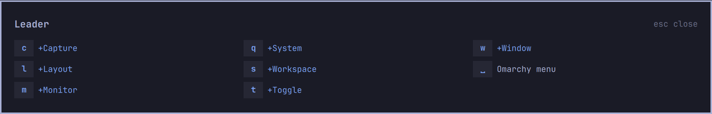

# Omaleader

A LazyVim / which-key style leader menu for [Omarchy](https://omarchy.org/).
Press a leader shortcut, then plain single keys (`w` `r` `l l l`) instead of
finger-twisting chords. A popup at the bottom of the screen lists the keys
available at each step, so you don't have to remember them.



It's an Omarchy shell plugin (QML), so it follows the current Omarchy theme.
Each key runs a Hyprland dispatcher or a shell command that you define in your
own keymap.

## Requirements

Omarchy with the Quickshell-based shell and Lua Hyprland config (`hl.*` and
`o.*` in `~/.config/hypr/`). No other dependencies.

## Install

```sh
omarchy plugin add https://github.com/tjtuom/omaleader --enable
```

Omaleader doesn't bind a key itself or touch your Hyprland config. Add the
leader binding yourself, e.g. in `~/.config/hypr/omaleader.lua`, then add
`require("hypr.omaleader")` to the end of `~/.config/hypr/hyprland.lua`:

```lua
-- Replaces the stock Omarchy menu on Super+Space; the example keymap puts it
-- on Super+Space then o.
o.rebind("SUPER + SPACE", "Leader menu", hl.dsp.global("omaleader:toggle"), { submap_universal = true })

-- Omaleader switches Hyprland to this submap while it's open, so a still-held
-- Super doesn't turn the next key into a Super bind (Super+W closing a window).
hl.define_submap("omaleader", function()
  hl.bind("SUPER + F23", hl.dsp.no_op()) -- a submap needs one bind to exist
end)
```

Any free shortcut works as the leader; keep the `submap_universal = true`
option so the same shortcut still reaches Omaleader while the menu is open.

## Keymap

Your keymap lives in `~/.config/omarchy/omaleader.jsonc`. Omaleader only reads
it and never writes it. Until that file exists, the bundled
[`keymap.example.jsonc`](keymap.example.jsonc) is used: copy it there as a
starting point. Saved changes apply immediately.

```sh
cp ~/.config/omarchy/plugins/tjtuom.omaleader/keymap.example.jsonc ~/.config/omarchy/omaleader.jsonc
omarchy-shell shell rescanPlugins   # once, so it starts watching your new file
```

```jsonc
{
  "w": { "label": "Window", "keys": {
    "q": { "label": "Close", "dispatch": "hl.dsp.window.close()" },
    "r": { "label": "Resize", "keys": {
      "l": { "label": "Wider", "dispatch": "hl.dsp.window.resize({ x = 50, y = 0, relative = true })", "stay": true },
    }},
  }},
  "space": { "label": "Previous workspace", "dispatch": "hl.dsp.focus({ workspace = \"previous_per_monitor\" })" },
}
```

Each key is a single character (case-sensitive) or one of `space`, `tab`,
`enter`, `left`, `right`, `up`, `down`. Entry fields:

| Field      | Meaning |
|------------|---------|
| `label`    | Text shown next to the key. |
| `keys`     | Makes the entry a group with its own nested keymap. |
| `dispatch` | Hyprland Lua dispatcher, same syntax as `bindings.lua` (`hl.dsp.…`, Omarchy's `o.…` helpers). |
| `exec`     | Shell command, run with `bash -lc`. |
| `stay`     | `true` keeps the popup open after running, so the key can repeat. |

In the popup, Backspace goes up a level and Esc closes it. Pressing the leader
shortcut again counts as Space at the current level, like LazyVim's
`<leader><leader>`: with the example keymap, Super+Space twice jumps back to
the previous workspace. A level without a `space` entry closes the menu
instead.

The keymap runs whatever commands you put in it, with your user's
permissions, inside the Omarchy shell. Only add commands you trust.

## IPC

```sh
omarchy-shell omaleader toggle   # or: hide, isOpen
```

## Remove

```sh
omarchy plugin remove tjtuom.omaleader
```

Then delete the leader binding you added (`~/.config/hypr/omaleader.lua` and
its `require` line) and run `hyprctl reload`; Super+Space returns to the stock
Omarchy menu. Delete `~/.config/omarchy/omaleader.jsonc` too if you no longer
want your keymap.

## Development

Clone the repo anywhere and link it in place of an installed copy:

```sh
ln -s ~/Dev/omaleader ~/.config/omarchy/plugins/tjtuom.omaleader
omarchy plugin validate ~/Dev/omaleader
```

Saved changes to the QML reload automatically.

## License

[MIT](LICENSE)
